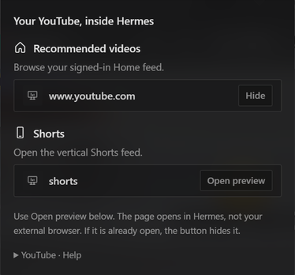

# YouTube Dock for Hermes Desktop

Browse **your YouTube recommendations and Shorts beside your conversation**, without opening your external browser or pasting video URLs.

A small, desktop-only launcher built with the public `@hermes/plugin-sdk`. It reuses Hermes' existing internal Browser; it is not a separate browser engine or a replacement YouTube player.



## Install

Requires **Hermes 0.22.2 or later** and the native Desktop app. This release was exercised on Windows 11 with Hermes 0.22.2. The SDK-based UI is not OS-specific, but macOS/Linux playback has not been manually verified.

### Desktop

Open the Desktop plugin installation dialog (**Capabilities → Plugins → Install from Git**), enter:

```text
https://github.com/metamindedu/hermes-youtube-dock
```

Select the Desktop component and confirm installation. Enable **YouTube Dock** in **Capabilities → Plugins** if it is not already enabled. Public packages are opt-in; the plugin itself defaults to disabled.

### CLI

```sh
hermes plugins install https://github.com/metamindedu/hermes-youtube-dock
```

Then open Hermes Desktop, rescan plugins if necessary, and enable **YouTube Dock**. There is no Python backend to configure or enable.

A catalog submission is pending; installation by the short catalog name is not available until the maintainers merge the entry and publish the catalog.

## Use

1. Click **▶ YouTube** in the titlebar, or search **YouTube** in the command palette.
2. Under **Recommended videos** or **Shorts**, click **Open preview**.
3. Browse, select and watch videos inside the native Browser next to the chat. No video URL is needed.
4. Drag the Browser tab or its panel boundary to arrange/resize it. Existing Hermes Browser tab actions handle pinning and opening a separate Hermes window.

English and Korean UI strings are included. Other locales fall back to English.

### Important behavior and limitations

- **The preview buttons are toggles.** An already-open original destination shows **Hide**, even if you navigated from Home to a video. Clicking it hides that Browser tab; clicking **Open preview** afterward opens the destination again. To return Home without hiding the tab, use YouTube's own logo inside the page.
- The existing native Browser decides which tab to reuse. This plugin does not create or manage its own browser session.
- A **dedicated PIP button is not included**. This release uses Hermes' docked Browser and its existing separate-window feature; neither is a promise of always-on-top PIP.
- An existing internal-Browser login can be reused. The plugin does not copy your external Chrome/Edge login. Google may restrict sign-in on embedded browsers; sign-in and playback are owned by the host and YouTube, not bypassed by this plugin.
- YouTube region, account, age and playback restrictions still apply. No Premium features or ad blocking are provided.
- Disabling this launcher removes its menu and command, **not** an already-open Browser/video tab. Close that tab to stop playback and release its resources.
- Keeping an external browser closed may help your workflow, but **no measured CPU or RAM savings are claimed**.
- The native preview cards and `#preview/` link behavior depend on the host's current SDK-rendered Markdown pipeline. A scoped stylesheet hides the unrelated Download button only inside the plugin's own cards; no other app markup is queried or modified.

## Privacy and permissions

| Surface | What happens |
| --- | --- |
| Third-party network | After an explicit click, the native Browser loads YouTube and its normal service/CDN requests. YouTube's own privacy terms apply. |
| Credentials | None requested or read by this plugin. Any saved sign-in remains managed by the native Browser. |
| Local data | No cookie, account, recommendation, watch-history or filesystem reads. No plugin persistence. |
| Agent capabilities | No tools, hooks, middleware, model calls or environment variables. |
| Native execution | No shell commands, backend service, extra browser process launcher, background worker or polling loop. |
| Telemetry | None. |
| Updates | No self-updater or remote code loader. Catalog versions, if accepted, are exact-SHA pinned and updated through Hermes. |

## Development and tests

Node is required for **development tests only**, not to run the installed plugin.

```sh
npm ci --ignore-scripts
npm run check
```

The portable unit tests use real React server rendering with a small, explicitly mocked SDK. To additionally verify round-tripping through the real Hermes native preview decoder, set `HERMES_SOURCE_ROOT` to a Hermes source checkout before running the same gate:

```sh
HERMES_SOURCE_ROOT=/path/to/hermes-agent npm run check
```

CI runs both on Windows and Linux against a pinned Hermes 0.22.2 source revision. Tests do not read or write a user's Hermes profile. Actual Desktop verification additionally covered the titlebar menu, signed-in Home feed, Shorts navigation and playback. The screenshot above is a crop of only the plugin menu; no account details or recommendation feed are published.

## Support and license

Report bugs through [GitHub Issues](https://github.com/metamindedu/hermes-youtube-dock/issues). Include Hermes version, OS, and whether the native Browser itself can play the same page. Do not include cookies, tokens or account credentials.

[MIT](LICENSE). An independent community plugin, not affiliated with or endorsed by YouTube, Google or Nous Research.

---

### 한국어

앱 상단 **▶ YouTube → 추천 피드 / 쇼츠 → Open preview**에서 내 유튜브를 Hermes 내부 브라우저로 엽니다. 개별 영상 URL을 넣을 필요가 없습니다. 기존 내부 브라우저의 로그인 상태를 사용하며, 외부 브라우저의 쿠키를 복사하거나 계정 정보를 읽지 않습니다. 설치 후 **Capabilities → Plugins → YouTube Dock**을 켜세요. 이 버전은 도킹형 패널 방식이며 전용 PIP 버튼은 없습니다.
